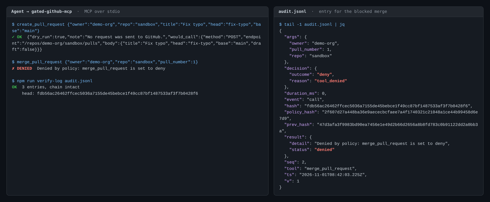

# gated-github-mcp

An MCP server that lets an AI agent work with GitHub **only within a policy file you control**, and records every call (allowed, denied, dry-run or failed) in a **tamper-evident audit log**.



*Real output from `npx tsx scripts/demo.ts`: a pull request is dry-run, a merge is denied by policy, the denial is in the hash-chained log, and `verify-log` confirms the chain.*

## Why

Giving an agent a GitHub token is all-or-nothing: whatever the token can do, the agent can do. This server puts a small, auditable layer in between:

- **Policy, deny by default.** Each tool is `allow`, `deny` or `dry_run`, and only allowlisted repos can be touched. Anything not explicitly allowed is refused.
- **One choke point.** Every tool call, including unknown tool names and malformed arguments, goes through a single `execute()` function that decides, runs and logs. Tests enforce that nothing else calls GitHub.
- **Audit log you can verify.** Append-only JSONL, each entry linked to the previous one by SHA-256. Editing, deleting or reordering any entry is detected by `verify-log`.
- **Fails closed.** A missing or invalid policy, an unreadable or tampered log, or a failed log write stops the server or refuses the call. It never proceeds unrecorded.

The tool set is intentionally small:

| Tool | Kind |
|---|---|
| `list_issues`, `get_issue`, `get_ci_status` | read |
| `comment_on_issue`, `create_pull_request`, `merge_pull_request` | write |

`merge_pull_request` exists mainly to show being blocked.

## Setup

Requires Node 20+.

```bash
git clone https://github.com/EPW80/gated-github-mcp.git
```

```bash
cd gated-github-mcp && npm install && npm run build
```

Create a **fine-grained** personal access token, scoped to **one sandbox repo** only, with:

| Permission | Access |
|---|---|
| Issues | Read and write |
| Pull requests | Read and write |
| Commit statuses, Checks | Read |
| Metadata | Read (required) |

Do **not** grant *Contents: write*. GitHub requires it to merge, so the token itself can't merge even if the policy is changed (see the threat model below).

The server reads three environment variables, all required:

| Variable | Purpose |
|---|---|
| `GITHUB_TOKEN` | The fine-grained token above |
| `POLICY_PATH` | Path to your policy file. There is no default. |
| `AUDIT_LOG_PATH` | Where the JSONL audit log is written (created if missing, mode 600) |

## The policy file

```yaml
version: 1

repos:                      # exact owner/repo names, case-insensitive, no wildcards
  - your-user/your-sandbox-repo

tools:                      # allow | deny | dry_run; unlisted tools are denied
  list_issues: allow
  get_issue: allow
  get_ci_status: allow
  comment_on_issue: allow
  create_pull_request: dry_run
  merge_pull_request: deny  # deliberately blocked
```

A copy is in [`policy.example.yaml`](policy.example.yaml).

**At startup**, any of these stop the server with an error: `POLICY_PATH` unset, file missing or unreadable, invalid YAML, duplicate keys, wrong `version`, unknown keys, an unknown tool name (so a typo can't silently deny a tool you meant to allow), `dry_run` on a read tool, or a malformed repo entry. The policy is loaded once, so changes need a restart, and every log entry carries the policy's SHA-256.

**For each call**, the first matching rule wins:

1. Unknown tool → deny (`unknown_tool`)
2. Tool not in the policy, or set to `deny` → deny (`tool_not_in_policy` / `tool_denied`), before arguments are even parsed
3. Arguments fail the tool's strict schema → deny (`invalid_arguments`)
4. `owner/repo` not on the allowlist → deny (`repo_not_allowed`)
5. `dry_run` → return the exact request that *would* be sent; GitHub is not called
6. `allow` → call GitHub
7. Anything unexpected in the policy check → deny (`policy_error`)

## Connecting to Claude Code

Register the server at **user scope**, so the token is not stored in a project file the agent can read:

```bash
claude mcp add gated-github --scope user \
  -e GITHUB_TOKEN=github_pat_... \
  -e POLICY_PATH=$HOME/.config/gated-github/policy.yaml \
  -e AUDIT_LOG_PATH=$HOME/.local/state/gated-github/audit.jsonl \
  -- node /absolute/path/to/gated-github-mcp/dist/index.js
```

Then, in a Claude Code session, ask it to list the sandbox repo's issues, comment on one, open a PR (you'll get the dry-run plan), and merge it (denied, and logged). Read the threat model before relying on this.

## Verifying the audit log

```bash
npm run verify-log -- ~/.local/state/gated-github/audit.jsonl
```

```
OK  16 entries, chain intact
    head: 9d96207a8843314322d53b0c039c3136d0f56b7831f008c6e1a2cb42e514a404
```

On a tampered log it reports the first bad entry and exits 1 (exit 2 if the file can't be read):

```
FAIL  audit.jsonl
    first bad entry: line 2 (seq 1)
    problem: entry contents do not match its hash (entry was edited)
```

It detects edited, deleted, reordered, duplicated and reformatted entries. The server also verifies the whole log at startup and refuses to start on a tampered one.

Each entry records the timestamp, event (`start`, `intent` or `call`), tool, arguments (secrets redacted), policy hash, decision and reason, result or error, duration, and the previous entry's hash. Allowed **write** calls get an `intent` entry *before* GitHub is called; if that can't be written, the call is refused.

## Threat model

The agent is assumed to be capable and possibly misdirected (prompt injection from an issue body, for example). The question is what it can do with GitHub, and whether you can tell afterwards.

**What the server enforces**
- Only allowlisted repos, only allowed tools, only well-formed arguments. Strict schemas reject extra fields, cross-repo PR heads (`other:branch`) and git refs that would rewrite the request path (`..`).
- Denied and dry-run calls never construct a GitHub client.
- Secrets are redacted from the log and from error text returned to the agent: the configured token by exact value, common credential formats by pattern, and any value under a key like `token` or `password`.
- Nothing is written to stdout except the MCP protocol: diagnostics go to stderr, and a lint rule bans `console.log`.

**The scoped token is defense in depth.** The policy is the first wall; the token's permissions are the second. Scoped to one repo without *Contents: write*, the token can't touch other repos or merge, even if the policy file is edited or the server has a bug.

**What it does not protect against: an agent that can reach around it.** This is the most important limitation. In Claude Code the agent has a shell and file access on the same machine, so the gate only holds if the agent cannot:

- **Use the token directly.** Don't export `GITHUB_TOKEN` in the shell you launch Claude Code from, don't keep `gh` logged in, and don't put the token in a project `.mcp.json`.
- **Edit the policy or the log.** Keep both outside the project folder. Edits are *visible* (the policy hash changes in the log; log tampering fails verification) but not *prevented*.

Claude Code permission rules narrow this. For example, in `~/.claude/settings.json`:

```json
{
  "permissions": {
    "deny": [
      "Read(~/.claude.json)",
      "Read(~/.config/gated-github/**)",
      "Edit(~/.config/gated-github/**)",
      "Edit(~/.local/state/gated-github/**)",
      "Bash(gh:*)",
      "Bash(curl:*)"
    ]
  }
}
```

Shell deny rules are a speed bump, not a sandbox (a script can still read files). For a hard boundary, run the server as a different OS user or in a container the agent can't reach.

**Audit log limits.** The hash chain proves the log is *consistent*, not that it is *complete*. Without a secret key, someone with write access can rewrite the whole file with fresh hashes. Removing the newest entries while the server is stopped is also undetectable. Record the `head` hash that `verify-log` prints somewhere the agent can't write, and compare later. While the server runs, any outside change to the log file is detected and all further calls are refused.

## Development

```bash
npm test
```

```bash
npm run lint
```

```bash
npx tsx scripts/demo.ts
```

The test suite (Vitest, Octokit mocked) covers the policy decisions, fail-closed loading, dry-run making no API calls, error and secret handling, log tampering, and a regression test for each finding from the security review. Two structural tests fail if anything other than `src/tools/execute.ts` calls a tool handler, or anything other than the GitHub client and tool definitions imports Octokit.

```
src/
  index.ts            entry point: load policy, open log, serve over stdio
  server.ts           one ListTools and one CallTool handler
  tools/execute.ts    the single path: decide → (intent) → run → log
  tools/definitions.ts  the six tools: Zod schema, handler, dry-run plan
  policy/             load.ts (fail-closed loader), decide.ts (pure rules)
  audit/              chain.ts, log.ts, redact.ts, verify.ts
  cli/verify-log.ts
```

**Design note:** the server uses the MCP SDK's low-level `Server` class, not `McpServer.registerTool`. `McpServer` validates arguments and rejects unknown tools *before* any tool callback runs, so those calls would bypass the policy check and never be logged.

## Next

Deliberately out of scope for now:

- **Signed or anchored log.** An HMAC key held outside the agent's reach, or periodically publishing the `head` hash, would make whole-log rewrites and tail truncation detectable.
- **Finer policy.** Per-repo tool modes, `owner/*` wildcards, argument constraints (e.g. PRs only into `main`, comment length limits) and rate limits.
- **Policy hot reload.** A restart is required today, which keeps the rules fixed for a session.
- **OpenTelemetry.** One span per tool call (planned as a stretch goal).
- **Other trackers, remote transport, multiple users, UI.** No Jira or Linear, no HTTP transport or OAuth, single user, no UI.
